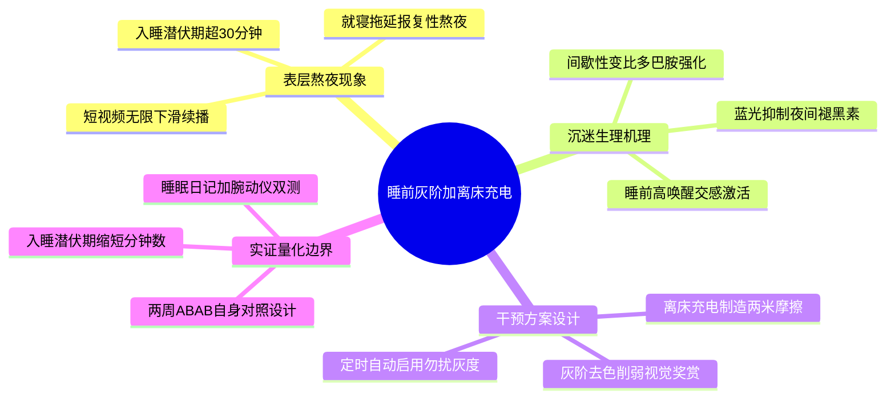

# outline_spec — 题眼立论、思维导图与段落槽位规约

> 本文件是 `report.md` 母稿的"图纸"：先定题眼与立论，再以 Mermaid 思维导图展开论证骨架，最后逐段规约槽位（每段承载哪个事实、达到什么功能）。改稿先改此文件，避免母稿结构漂移。

## 1. 题眼（Thesis Kernel）

- **题眼（一句话）**：睡前开启手机灰阶模式与离床充电隔离，阻断短视频多巴胺唤醒并显著缩短大学生入睡潜伏期。
- **问题意识**：短视频的间歇性奖赏与蓝光暴露使大学生普遍入睡延迟，"想睡停不下来"成为可干预的行为问题。
- **立论（Claim）**：通过降低视觉奖赏（灰阶）与增加取用摩擦（离床两米充电）的双重干预，可显著缩短入睡潜伏期并改善次日困倦。
- **反方预设（Antithesis）**：入睡延迟可能主要源于焦虑等心理因素而非手机使用；灰阶模式可能被快速手动关闭，摩擦干预不可持续。

## 2. Mermaid 思维导图

## 3. 章节拓扑（线性化投影，先验依赖无缺）

| 章 | 层级职能 | 依赖前置 |
| --- | --- | --- |
| 第 1 章 熬夜现象 | 问题层：锚定待解释现象 | 无 |
| 第 2 章 沉迷机理 | 解释层：解释第 1 章现象成因 | 第 1 章 |
| 第 3 章 断网干预对照实证 | 验证层：把机理转为干预并检验 | 第 1、2 章 |
| 第 4 章 结论与边界 | 收束层：收敛主张、声明外部效度 | 第 1–3 章 |

## 4. 段落槽位规约（第 3 章细化）

| 槽位 ID | 段落与修辞职责 | 承载事实 / 待填槽位 | 篇幅预算 |
| --- | --- | --- | --- |
| S-01 | 1.1–1.2 现象锚定，抛出题眼 | 待登记 | ~200 字 |
| S-02 | 2.1–2.3 三条机理通路 | 待登记 | ~300 字 |
| S-03a | 3.1 实验设置与基准：确立组间可比性 | [待填槽位：被试人数与纳入标准] [待填槽位：分组方案与随机化方法] [待填槽位：干预周期与依从性监测手段] [待填槽位：基线入睡潜伏期均值±SD] | ~250 字 |
| S-03b | 3.2 入睡耗时对比与机理归因：完成"数据→机制"闭环 | [待填槽位：各组干预后入睡潜伏期均值±SD] [待填槽位：组间差值、95%CI 与效应量 d] [待填槽位：统计检验方法与 p 值] [待填槽位：夜间屏幕使用时长变化] | ~350 字 |
| S-03c | 3.3 早八困倦率验证：以次日功能结局做外部效度 | [待填槽位：早八第一节课自评困倦比例] [待填槽位：KSS 嗜睡量表评分变化] [待填槽位：脱落率与依从完成率] | ~250 字 |
| S-04 | 4.1–4.2 结论与边界 | 待登记 | ~200 字 |

## 5. 规约（写作纪律）

1. **单一事实源**：任何事实只允许登记在 `raw_data.json`，母稿用 `(F001)` 形式引用。
2. **改图先于改文**：结构变更先更新本文件的导图与槽位表，再同步母稿。
3. **篇幅预算**：超出预算 20% 以上需回本文件重新分配，而不是就地膨胀。
